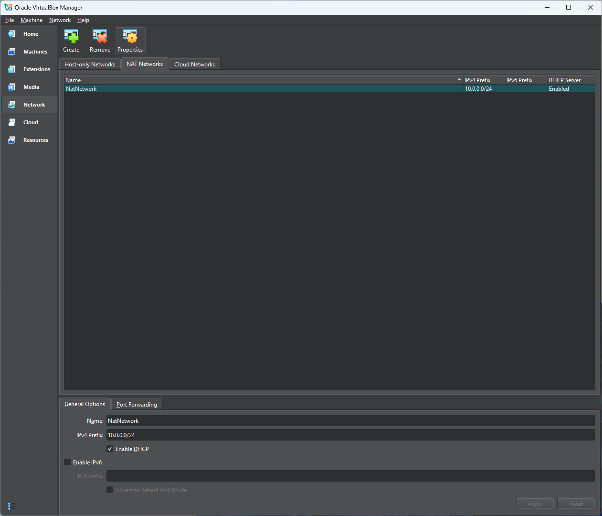
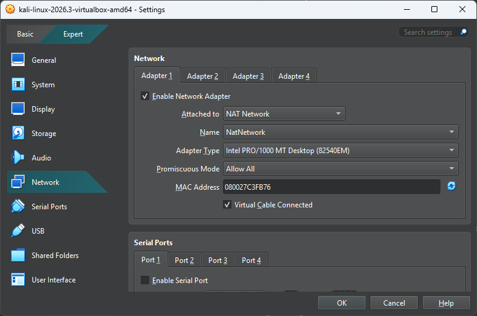
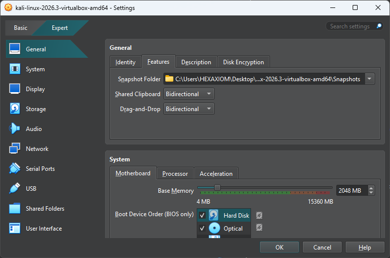
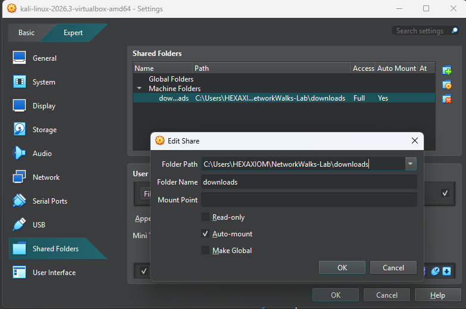
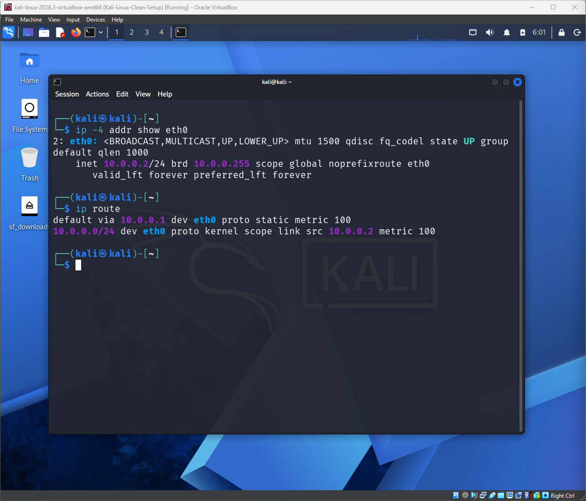
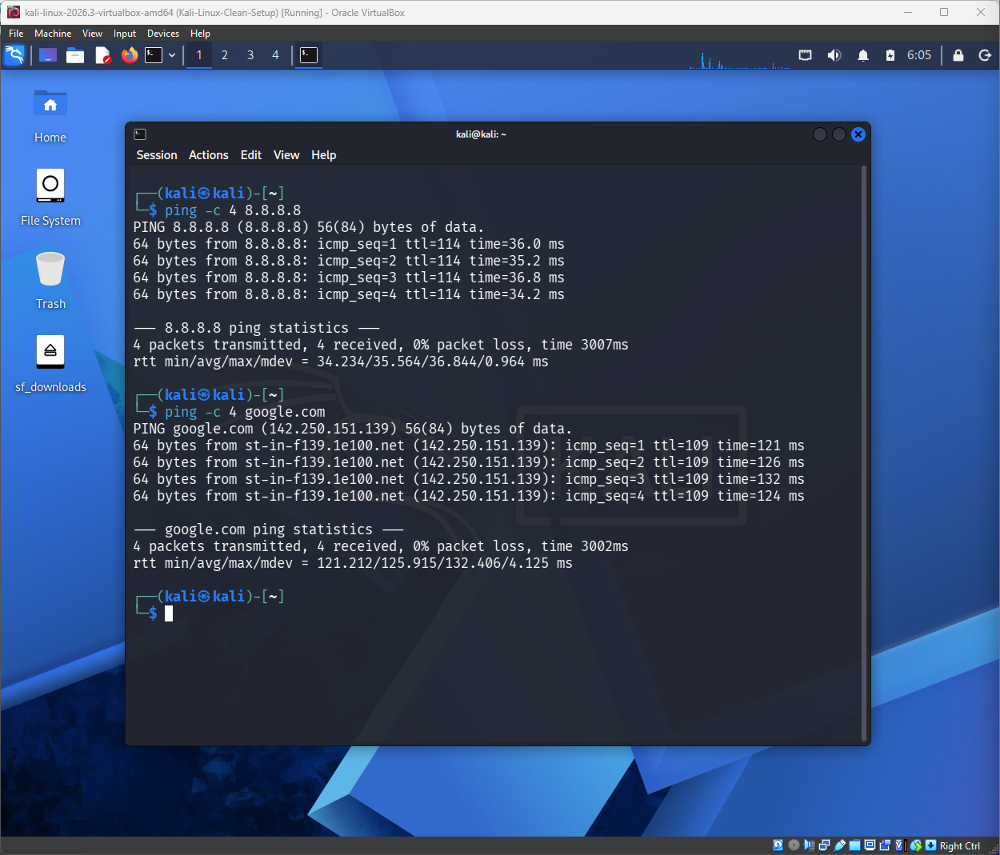
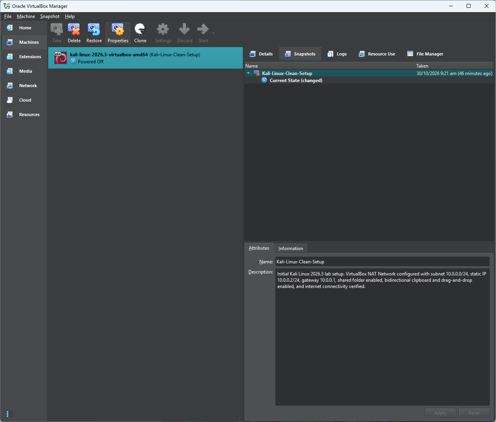

# NetworkWalks Cybersecurity Internship 2026

## Week 1 – Project Module 1: Lab Setup with VirtualBox and Kali Linux

**Participant:** SENUNYEME KWABENA YOUNG
**Batch:** B084
**Project Code:** WK1-PM1
**Project:** Lab Setup VirtualBox and Kali Linux v4.2

---

## 1. Project Overview

This project involved setting up a virtual cybersecurity laboratory using Oracle VirtualBox and Kali Linux.

The objective was to create a functional virtual environment for cybersecurity learning and practical exercises, with network connectivity and shared-folder functionality.

## 2. Tools and Technologies Used

* Oracle VirtualBox 7.2.22
* Kali Linux 2026.3
* 7-Zip
* VirtualBox NAT Network

## 3. Lab Network Configuration

The virtual laboratory was configured using the following network settings:

| Configuration         | Value       |
| --------------------- | ----------- |
| Network Type          | NAT Network |
| Network Name          | NatNetwork  |
| Network Subnet        | 10.0.0.0/24 |
| Kali Linux IP Address | 10.0.0.2/24 |
| Default Gateway       | 10.0.0.1    |
| DNS Server            | 8.8.8.8     |
| DHCP                  | Enabled     |

## 4. Virtual Machine Configuration

The Kali Linux virtual machine was configured with:

* Network Adapter connected to the NatNetwork.
* Promiscuous Mode set to Allow All.
* Shared Clipboard set to Bidirectional.
* Drag and Drop set to Bidirectional.
* Shared folder configured with auto-mount enabled.
* Internet connectivity successfully tested.

### Shared Folder Configuration

* Folder Name: `downloads`
* Auto-mount: Enabled
* Read-only: Disabled

## 5. Internet Connectivity Verification

Connectivity was tested using the following commands.

**IP connectivity test:**

```bash
ping -c 4 8.8.8.8
```

**DNS resolution and connectivity test:**

```bash
ping -c 4 google.com
```

Both tests completed successfully with 0% packet loss.

## 6. Evidence and Screenshots

The following screenshots document the lab configuration and verification.

### 1. NAT Network Configuration



### 2. Kali Linux Network Adapter



### 3. Clipboard and Drag-and-Drop Configuration



### 4. Shared Folder Configuration



### 5. Kali Linux IP Configuration



### 6. Internet Connectivity Tests



### 7. VirtualBox Snapshot



## 7. Virtual Machine Snapshot

A VirtualBox snapshot named `Kali-Linux-Clean-Setup` was created after completing the initial configuration and verifying internet connectivity.

This snapshot provides a clean starting point for future lab activities.

## 8. What I Learned

Through this project, I gained practical experience in:

* Installing and configuring VirtualBox.
* Creating and configuring a NAT Network.
* Importing and setting up a Kali Linux virtual machine.
* Configuring a static IPv4 address.
* Configuring shared folders between a host and virtual machine.
* Enabling bidirectional clipboard and drag-and-drop.
* Testing network connectivity and DNS resolution.
* Creating virtual machine snapshots.

## 9. Conclusion

The initial cybersecurity virtual laboratory was successfully established using VirtualBox and Kali Linux.

The network configuration, shared-folder functionality, internet connectivity, and snapshot creation were completed and verified.

This environment provides a foundation for future cybersecurity practical exercises.

---

**Programme:** NetworkWalks Cybersecurity Internship 2026
**Participant:** SENUNYEME KWABENA YOUNG
**Batch:** B084
**Project Code:** WK1-PM1
